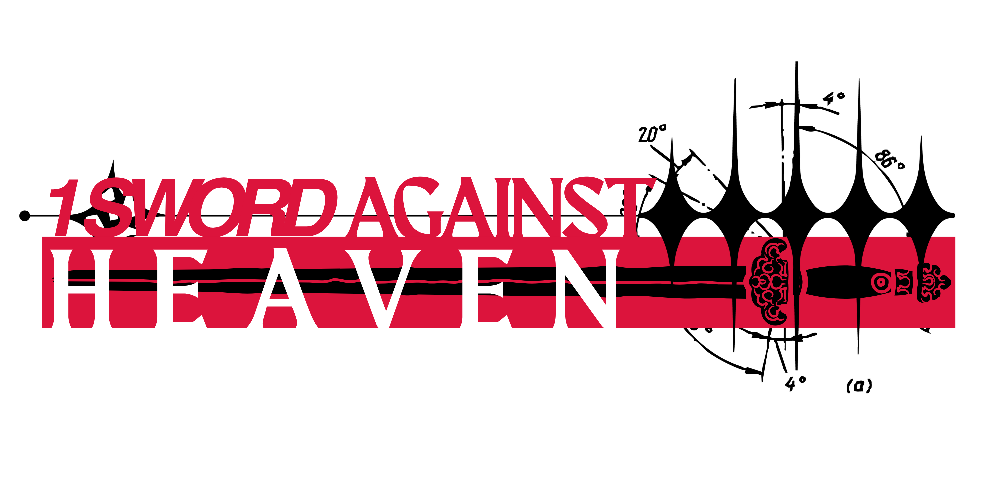

# 10,000 Swords Against Heaven for Foundry VTT

A Foundry VTT v14 game system for *10,000 Swords Against Heaven*, based on rules version 2.0.3.

- System by: Geek IO Dev Team

  

[Official 10K Swords Discord Link](https://discord.gg/k8fHKrNP)  
[Official Geek IO Discord Link](https://www.geek-io.net/discord)  

# v 0.1.51

- Kept the Force OCR checkbox beside its label and moved the explanation below it.
- Matched the Mass Importer step bubbles to World Being · Text, with detailed formatting guidance tucked into an expandable section.

# v 0.1.50

- Added local PDF text extraction and English OCR to **Mass Importer** and **World Being · Text**, with page ranges, progress, cancellation, and editable extracted text before preview.
- **World Being · Manual** now accepts items dragged from the compendium browser or Items directory. Review and remove starting items before creation; their embedded effects are preserved.
- PDF reading supports up to 20 pages per operation and files up to 100 MB. OCR output should be reviewed for names, columns, symbols, and numbers.

# v 0.1.49

- Added **World Being · Manual** to the importer: enter a name, Actor folder, resources, movement, Siddhi, Magnetite, and all six Cultivations. Creation opens the sheet and keeps the importer available.
- Cleaned up text importing with grouped steps, a dedicated upload area, expandable instructions, and an advanced preview editor.

# v 0.1.48

- Fixed World Being imports rejecting names containing commas, including multiple stat blocks in one batch.

# v 0.1.47

- Fixed destination folders in the Item and Mass Importer. Existing Item folders are available even before the sidebar displays them, with hierarchy and alphabetical sorting preserved.

# v 0.1.46

- Added **World Being Traits**: all 16 entries from page 213, with supported numeric Active Effects and conditional bonuses disabled until needed.
- Added **Sect Fashion & Gear**, organized by Sect and item type: 34 equipment cards represented by 37 entries, including all four Houyi Tonggong weapon forms.
- Added all **12 Jobs**, organized into Body and Mind, with printed Cultivations and independent starting loadouts. Wretched preserves its player-selected choices.
- Release ZIPs now include all **eight compendiums**. See [catalog details and manual mechanics](docs/expansion-catalogs.md).

# v 0.1.45

- Equipped **Hermetic Robes** automatically add **1 m to Magick area sizes**, following page 135. Scathe becomes a 2 m burst within its normal 6 m casting range.
- The bonus appears as a transferable Active Effect in the robes’ Effects tab and is suppressed while unequipped. Existing world and character copies receive the missing effect on GM world load.
- Added **Magick area size bonus (m)** to the Active Effect variable dropdown. The casting prompt shows automatic area bonuses.

# v 0.1.44

- Magicks, Technicks, and Special Abilities can place an area selector on the canvas and automatically target characters inside it.
- Bursts use their radius, blasts use triangular cones, and lines are 1 m wide. Scathe defaults to a 1 m burst within 6 m.
- Adjust shape, size, and placement range before casting. Cancelling placement spends no AP, Ardor, or ammunition.
- Existing imports can infer explicit area dimensions from their descriptions; no re-import is required.
- See [Area targeting](docs/area-targeting.md) for placement controls and targeting details.

# v 0.1.43

- Configured **69 Special Abilities on 64 Sect Technicks**, including weapon attacks, activation actions, rites, and triggered abilities. Use them under **Combat → Special Abilities**.
- **Six Demon Cutting Sword** requires a wielded Great/Colossal weapon, spends 2 AP and 1 Burn Ardor, and applies its +2 attack dice, Crushing, Blaze, and extra Wounds on 5s and 6s.
- Weapon-based abilities include the chosen weapon’s bonuses, modifiers, and ammunition. Installed activation abilities retain a Release control; variable Burn costs prompt for an amount.
- On GM world load, matching existing imports with empty Special Ability lists receive the configured actions. Existing custom lists and customized activation costs are preserved.
- Multi-attack sequences, movement, summons, conditional bonuses, and unusual effects retain explicit manual instructions. See [Technick action notes](docs/technick-actions.md).

# v 0.1.42

- Added optional **Automated Animations** support for weapon attacks, Magicks, Technicks, and Special Abilities.
- Configure animations using the module’s item controls or automatic name recognition. Special Abilities use their parent item’s animation configuration.
- Added a world setting to enable or disable this integration. Private rolls do not trigger scene animations.
- See [Automated Animations setup](docs/automated-animations.md).

# v 0.1.41

- Added **Sect Licenses**, **Sect Technicks**, and **Sect Magicks** compendiums covering the 15 sects on pages 127–185.
- Includes **156 Licenses**, **74 Technicks**, and **52 Magicks**, organized into **Sect → Novice / Expert / Master** folders. Each ability links to its matching License.
- Includes source pages, prerequisites, descriptions, and explicit AP/Ardor costs. Magicks include printed Mantras and Mudras, with explicit attack fields where available.
- Variable costs, conditional mechanics, and requirements for other Licenses remain in the descriptions for manual handling. See [Sect catalog notes](docs/sect-catalog.md).

# v 0.1.40

- Moved all 12 generic weapons into the **Weapons** compendium folder and removed the separate **Weapon Patterns** folder.
- Removed “(Pattern)” from their names. All entries use the **Weapon** item type; their stats and IDs are preserved.
- First public release on Github.

# v 0.1.39

- Body text and controls now use bundled **Inter**.
- Section headings use **Times New Roman**. Major headings prefer **ITC Benguiat**, falling back to Times New Roman when Benguiat is not installed on the viewing computer.
- The supplied logo and Foundry’s icon fonts remain unchanged.

# v 0.1.38

- Gear has configurable **Consumable recovery** fields and a **Use** button in character Inventory. Use confirms, restores Health/burnt Ardor, and consumes one item in the same saved update.
- Configured Elixir Chakra Pill (+1 burnt Ardor recovered), Elixir Magnesium Pill (+2), Elixir Healing Vial (+1 Health), and Inter-Elix Soma (all Health and burnt Ardor) from p.94.
- Recovery respects maximum Health and available burnt Ardor, leaves installed Ardor intact, and adjusts Carry when a stack is spent. Empty stacks and uses with no recovery benefit spend nothing.
- These consumables cost 1 AP in active combat (p.64), configurable on the item. Outside combat they spend no AP.

Import fresh copies of the four configured items, or edit existing Gear → Consumable recovery to configure them. Other consumables’ timed bonuses, injuries, and immunities remain descriptive in this pass.

# v 0.1.37

- Fixed the compendium database format for embedded Active Effects. Trait items now contain effect references and separate effect records that Foundry can load, so their own **Effects** tab contains the actual changes.
- Adamance contains a transferring **Maximum Health → Add → Trait Level** effect. The other configured Traits retain their individual changes and activation controls.
- On the first GM world load, recognizable Grimoire Trait copies with empty Effects tabs receive their missing effects. This includes world items, owned items, and unlinked token copies. Existing effects and customizations are preserved.
- The repair runs once; intentionally removing an effect afterward will not cause it to be recreated every session.

# v 0.1.36

- The character’s **Effects** tab now includes transferred effects from Traits and other owned items alongside effects attached directly to the character.
- Each entry shows its source, Active/Disabled/Suppressed/Inactive status, and exact stat changes. Suppressed effects explain that their source item must be activated or equipped.
- Edit, Enable/Disable, and Remove target the correct owned effect, even when multiple copies share an effect ID. Compendium and world originals remain independent.
- Existing character items appear automatically; no re-import is needed.

# v 0.1.35

- Moved the sheet logo to the upper right, with the portrait and name sharing the upper-left space.
- Fixed Trait activation: **Activate** enables the primary effect if all effects were disabled. Enabling an individual situational effect also activates its parent Trait. **Deactivate** suppresses the Trait’s effects.
- Updated compendium defaults: Adamance is automatic; conditional Traits start inactive with their primary effect configured and ready for Activate. Separate bonuses/penalties remain individually selectable.
- Existing 0.1.34 Trait copies work with the corrected controls; no re-import is required for this fix.

# v 0.1.34

- Character sheets use the supplied **1 Sword Against Heaven** logo in a compact, responsive header.
- Grimoire Traits include 44 Active Effects across 33 Traits. Bonuses and penalties scale with Trait Level; Adamance increases maximum Health automatically.
- **Identity → Traits → Situational effects** offers individual Enable/Disable controls. Enable only the effects relevant to the current situation, then disable them when the benefit or duration ends. The Trait’s main Activate/Deactivate button controls all its effects.
- Oracle Soul, Chills, and Tenth Sense retain their descriptions without invented stat modifiers. See the [Trait effects guide](docs/trait-effects.md) for manual secondary benefits and usage limits.

Updated effects apply to newly imported compendium Traits. Existing world/character copies are independent; replace those copies from the updated compendium to receive these definitions, preserving any custom Level or edits you need.

# v 0.1.33

- Right-click an item on a Wanderer or World Being sheet and choose **Remove**. Removal also refunds that item's tracked resource reservations.
- Magicks and Technicks with Install costs show **Internalize**. Confirming use spends the configured AP, Burn, and Install costs. An internalized ability shows **Release**, which frees its tracked installed Ardor without refunding AP or burnt Ardor.
- Abilities without Install costs show **Activate** and can be used directly. Insufficient AP or Ardor prevents use; cancellation spends nothing.
- Inventory and Combat display **AP, Burn, and Install** costs together. Full Rest releases internalized abilities as it clears Ardor. Changing Jobs also releases installations belonging to removed Job grants.

# v 0.1.32

- **World Being matching:** searches world Items and visible Item compendiums, preferring world copies. Normalizes punctuation, possessives, capitalization, and PDF spacing. Matching duplicates no longer force a placeholder; preview names the selected source. Full descriptions, fields, and effects are copied. Microcosmic Orbit remains restricted to Technicks/Magicks.
- **Active Effect variables:** values such as `System.Level`, `@system.level`, and `2 * System.Level` read the owning Item's numeric fields. `@actor.system.movement` explicitly reads the Actor's base Movement. Changing Trait Level updates its effect without changing the saved base Cultivation.
- One **Importer** button in Items, Actors, and Compendiums opens the shared importer tabs.
- Traits and their Activate/Deactivate controls are now in **Identity**.
- Jobs have separate Weapons, Gear, Fashion, and Traits drop areas, with independent loadouts. Changing Jobs replaces only the previous Job's granted items and reverses their resource costs/bonuses; manually added items stay. Grant identity is scoped to its Job, including duplicated templates.
- Added **Grimoire Traits · Rules 2.0.3**, containing all 36 Traits from pp.114–120 with full text, Level, and source references. Animal Magnetism includes a switchable Level-to-Word effect; Adamance includes Level-to-Maximum-Health. Animal Magnetism starts inactive so its conditional bonus is applied only when appropriate. Other narrative/conditional mechanics remain described for the table to adjudicate.

# v 0.1.31

- **One importer window, three tabs:** Item Importer, Mass Importer, and World Beings. Item and Mass Importer buttons appear in both the Items and Compendium directories. Drafts and previews stay open after successful or failed imports.
- **Multi-Trait imports:** numbered book headings split into separate items. The Mass Importer explains separators and shows detected names/counts plus editable JSON before creation. Choose an Item folder for both single and bulk imports.
- **World Being importer:** parses the core-book stat-block layout, including numeric/star Cultivations, Health boxes, Movement, Ardor, Armor, money, and bracketed item sections. Matches visible world items by name; Microcosmic Orbit matches only Technicks/Magicks. Missing or ambiguous names become embedded placeholders, with supplied details retained and review notes.
- **Cultivation buttons:** book artwork from pp.26–27, names underneath, and book-description tooltips. Character items show their descriptions on hover.
- **Inventory:** separate type sections, drag sorting, alphabetical Auto-sort, and **Add New** to create a blank owned item and open its editor. New equipment starts unequipped; Carry overage is recorded rather than blocking blank-item creation.
- **Traits:** their own Combat section with Activate/Deactivate controls for configured transferred Active Effects. Movement has a prominent field and remains available to Active Effects.
- **New item types:** World Being Gambit (restricted to World Beings) and Salvage, with distinct bundled icons.
- **Jobs:** drop starting Items/Traits into the Job editor. Applying the Job copies those grants to the character once while retaining manual Cultivation adjustments and existing items. Removing a grant from the template does not delete an already-granted character item.
- **Compendium search:** names/descriptions plus tags, Sect, Sidhi, rank, and rarity; supports queries such as `tag:fire sect:asuri sidhi:2`.
- **Dice:** retained 4s/5s are cyan in expanded results; Perfect Strikes remain green.

World Being imports preserve printed resource totals and start equipment/Trait effects inactive to avoid automatically adding bonuses already included in those totals. Review the preview and activate/equip as appropriate. Arbitrary prose is retained, not converted into invented mechanics.

# v 0.1.30

- Worldbeings use the Wanderer Samadhi triggers: three Sixes or the first drop into Bloodied between rests. Existing Samadhi is not refreshed and burnt Ardor is recovered only on entry.
- New Round is directly below AP and above the Health Sutra.
- Armor is a clickable track inside the Health Sutra; numeric Armor inputs are removed. Capacity comes from Fashion and Active Effects.
- Renamed Special Attacks to **Special Abilities**, now supported by Weapons, Fashions, and Technicks. Existing attacks remain intact. Choose Attack, Check, or Automatic mode; zero-AP, non-rolling activations are supported.
- Automatic abilities can publish a configurable target modifier. A GM or target owner can apply/remove it on selected targets from chat. Reapplying the same ability updates its effect instead of stacking it. Range, duration, and conditional eligibility remain explicit table decisions.

# v 0.1.29

- Bulk text imports recognize repeated Name labels, book item headers, and multi-line Technick/Magick titles. Preview each detected entry before importing; use `---` for ambiguous layouts.
- Dice totals count Strikes (4, 5, and 6), including kept-low fallback rolls. Weapon attacks clearly label the miscellaneous bonus/penalty field for Fashion, Traits, and other adjustments.
- Technicks and Fashions gain a **Special Attacks** editor: names, notes, pools, damage type, bonuses, AP, burnt Ardor, and installed Ardor. Equipped items expose their attacks in the character's Combat tab.
- Added Blaze, Lacerating, and Toxic conditions. Blaze burns at combat round advances; Toxic has a 10-minute SPI check button; Lacerating adds one Wound to subsequent attacks with surviving Strikes. Linked Defense offers an explicit button to apply weapon-mod conditions, including Stun and Hobbled.
- Defense chat separates ordinary/Perfect Defenses, uncancelled Strikes, Wounds, Armor loss, and Health loss. Damage remains a calculation to confirm and apply.
- Eleven distinct default item icons by Lorc from [Game-icons.net](https://game-icons.net/), under CC BY 3.0. Custom art stays unchanged. See [icon attribution](assets/icons/ATTRIBUTION.md).

# v 0.1.28

- Imported names use Title Case; descriptions join wrapped lines into paragraphs. Bundled compendium entries receive the same cleanup.
- Gear now shows Magnetite (Mag) cost.
- Only Licenses have Meridian cost; Fashion, Technicks, and Magicks do not. Licenses no longer have Rarity.
- Existing characters refund recorded ability Meridian costs and account for equipped Licenses once. Excess costs display a warning until Licenses are unequipped.

# v 0.1.27

## Book imports and non-sect compendiums

- AP and Ardor now sit directly above the Health Sutra.
- Import destinations follow folder hierarchy, alphabetized within each parent.
- Removed Rarity from Jobs, Technicks, Magicks, and Traits. Jobs and Traits also lose quantity, Carry cost, and base bonus. Traits gain an editable, uncapped Level.
- Rulebook-text import recognizes complete item headers, symbols, prices, weapon patterns, Fashion bonuses, and ability costs/pools. Full text and an editable review remain available; uncertain and bespoke rules are not silently automated.
- Magicks can define an optional enhancement. Casting prompts Yes/No, applies configured extra AP/Ardor, dice, area size, and Wounds, and reports the choice. Simple optional burn clauses in pasted text are proposed for review.
- Added **Non-Sect Items · Rules 2.0.3**: 110 entries organized into 11 compendium folders, with source-page references covering item listings on pp.94–111, weapon patterns, ammo, and upgrade materials. Pages 92–93 describe brands rather than item records.
- See [Compendium coverage](docs/compendiums.md) for ambiguities and manual effects. Pack contents load with the system; they do not automatically populate the world Items directory.

# v 0.1.26

## Ability workflows and batch importing

- Choose an Item folder for single creation, the new batch queue, or file/text imports. Add different item types to the queue and import them together without closing the creator. Multiple files of the selected format can be imported together (200 items / 2 MB per file-import batch).
- License Sect is free text; Rank is Novice, Expert, or Master. Dracotine, Leonine, Mammon, and homebrew sects are accepted. Existing combined Sect/rank values migrate on load.
- Technicks and Magicks have their own Inventory sections and appear when internalized in Combat. They do not occupy equipment slots, including legacy slot assignments.
- Configurable AP, burnt Ardor, and installed Ardor costs; Use/Cast spends the configured resources. Automatic abilities can skip rolling. Cancellation spends nothing; failed chat creation restores costs.
- Magicks have damage type, Mantra, Mudra, required hands, attacking/defending pools, and area shape/size. Attack rolls link to Defense; the recorded defending pool is selected automatically. Area targeting and specific narrative effects remain manual.
- Removed the Maximum Health input. Continue adjusting maximum Health through Active Effects. Ardor uses ✹, installed Ardor uses ❂, and AP uses ✦; spent resources are dimmed.

# v 0.1.25

## Item details and native effects

- Weapon Affinity now has a dropdown in Universal Item Importer.
- Maximum Health effects add Hale levels to the Sutra; extra levels can be selected without changing base maximum Health. Raising maximum alone does not heal current Health.
- Active Effects opens Foundry’s standard editor directly, with variable dropdowns in its Changes tab. Duration, operations, priority, and other native controls remain together.
- Fashion has a Magnetite (Mag) cost field on its sheet and in the importer.
- Every item type has Rarity: Common, Uncommon, Enhanced, Rare, Deluxe, Prestige (PDF p.94). Inventory entries and item headers carry subtle color accents and rarity text.
- Existing items default to Common; rarity does not automatically set prices or upgrade tiers.

# v 0.1.24

## Universal item importer

- Open Universal Item Importer from the right-hand Items sidebar. Choose any supported item type and create successive items without closing the window.
- Type-specific fields, rich descriptions, remembered drafts when switching types, and an Edit last created shortcut.
- Successful creation resets fields for the next item while keeping the type. Invalid entries stay available to correct.
- Import files / rulebook text opens the existing reviewed JSON, CSV, and text import workflow.

# v 0.1.23

## Combat workflow and item importing

- Fixed window-control icons by keeping the custom font off Foundry icon buttons.
- Removed Archive from character sheets. Compendium Browser now opens from the Compendium sidebar; Import Items is available in the Items and Compendium sidebars.
- Renamed State to Combat and moved Health, conditions, Actions, Defense, and readied weapons/Magicks/Technicks there.
- Removed Armor from item creation. Legacy Armor loads as Fashion, retaining its original data in a recovery flag. Review Fashion bonuses and slot assignments on converted items.
- Interrupt now opens an opposed-response dialog: Clash cancels matching attack dice; Sabotage compares successes and reports a weakened-attack/disarm outcome. Actions, ammo, conditions, injury and Samadhi are accounted for.
- Added JSON, CSV, and pasted rulebook-text importing for all supported types, including Jobs, Licenses, Technicks and Magicks. Editable preview, model validation, duplicate skipping, and a downloadable JSON template precede creation.

# v 0.1.22

## The Archive and first UI pass

- Replaced Open with Edit on character and item sheets.
- Introduced a charcoal, ivory, and crimson visual style with locally bundled Barlow and Rajdhani Google Fonts. No runtime Google Fonts requests are required.
- Character sections: Overview, State, Inventory, Identity, Notes, and Effects. Item sections separate details, weapon configuration, description, and effects.
- Added The Archive, opened from the character sheet's Archive button. Search world items and accessible Item compendiums; filter by type or source; View entries or drag them onto character sheets.
- Archive indexes are cached, results load in batches, unavailable packs are reported, and Refresh reloads the library. No compendium content is bundled in this update.
- Tightened field spacing, inventory rows, headings, portrait sizing, condition cards, primary actions, and keyboard focus states.

# v 0.1.21

## Health states, linked Defense, and effect variables

- Health buttons now select the displayed Health level. The third starting Hale selects 4 Health and applies no penalty; Bloody begins at 3. Saved Health values are unchanged.
- Selected Hale is green, Bloody blood red, Critical bright red, and Knocked Out black with bold white text.
- Attack and Defense chat show total successes including sixes, with sixes still highlighted in green.
- Defense can select a recent visible attack created in this version. Rolls cancel Strikes and calculate Armor/Health loss using stored weapon properties; damage is reported, not applied automatically.
- Active Effects opened from the system sheet offer named variable dropdowns and Add/subtract, Multiply, or Set value. Existing custom modifiers are preserved; Advanced opens Foundry's full editor.

# v 0.1.20

## Rest, Bloodied Samadhi, and active conditions

- Wanderers enter Samadhi on their first damaging transition from Hale to Bloody or Critical between rests, including Health edits through token bars. Already-active Samadhi is not refreshed; that injury trigger is still used.
- Added Rest with “Would you like to perform a Full Rest?” confirmation. Yes heals 1 Health up to maximum, clears burnt and installed Ardor, ends Samadhi, restores three Actions, and resets the injury trigger. Full Rest requires one day and two meals (p.2); food and time are confirmed by the player.
- Added all eight p.78 conditions with descriptions and removable sheet checkboxes. Daze, Encumbered, Hobbled, Knockdown and Stagger modify effective statistics; attack, casting and Interrupt restrictions apply where relevant.
- Stun removes one Action when applied. Added remaining Actions, Spend Action, Interrupt, and New Round controls. Weapon attacks spend their action cost (two for Colossal); Cast spends one Action. New Round manually restores three Actions.
- Conditions are not automatically cured by Rest. Token dragging, speech, and actions outside system controls remain table-managed.

# v 0.1.19

## Defense, Magick, and Samadhi

- Added Cast beside equipped Magick. Casting is blocked without a free hand, even with Focus; the guard checks again after the dialog. Select the Magick's required Cultivation; SPI is the default. Listed costs/effects remain manual.
- Added Defense under Checks & Cultivations: VIO deflection, GRC/SAV avoidance, and wielded weapon Affinities. Includes injury, Active Effect, Shield, Samadhi, and selected Full Defense/Feint adjustments. Reports ordinary and Perfect Defenses separately.
- Sixes totals appear in bold green in system roll chat.
- Three or more retained sixes enter Samadhi unless already active, restoring one burnt Ardor if available. Subsequent checks gain +3. Duration follows the end of the next combat round or six seconds of Foundry world time; End Samadhi is available on the sheet.
- Automated Shield bonuses while wielded, Ritual bonuses for selected prayer/ritual checks, and Disarming bonuses for selected disarm checks.
- Hit-triggered target conditions and damage application remain manual.

# v 0.1.18

## Grouped attack options

- Organized attack options into bordered Targeting, Position & range, Attack tactics, and Weapon effects & adjustments sections.
- Aligned related fields and checkboxes with consistent spacing and shorter labels. Dual Attack guidance sits beneath its controls.
- Retained scrollable content and the fixed Roll footer.

# v 0.1.17

## Attack dialog layout

- Attack options use two columns and a scrollable content area, with the Roll button kept outside the scrolling region.
- The dialog is resizable and capped to the viewport height. Narrow screens use one column.
- Combat calculations and field values are unchanged.

# v 0.1.16

## Weapon attacks and combat modifiers

- Attack buttons now sit beside equipped weapons on the character sheet. Ordinary Cultivation checks no longer contain weapon attack controls.
- Weapons have Melee (VIO) and Ranged (GRC) types. Affinity still overrides the default Cultivation. Existing weapons default to Melee: change bows, guns, and other ranged weapons to Ranged.
- Melee reach uses whole metres (minimum 1 m), including range modifiers. Ranged attacks use the listed weapon range. Optional distance/elevation entries check reach using the larger distance (p.71); no automatic map measurement is claimed.
- Attack options calculate Flanking, Cleave, Cover, Concealment, Called Shot, Surprise, High Ground, Ultragravity, Sabotage, Dual Attack, and ranged-distance modifiers (pp.66, 70–71, 73).
- Multi-target attacks roll once and spend one tracked ammo per target. Area patterns waive Cleave, not ammunition use. Chat separates ordinary and Critical Strikes and lists situational modifiers.
- Dual Attack applies -3: roll each weapon separately and keep the better result. Defense, Clashes, wounds, environmental hazards, and forced movement remain table-resolved.

# v 0.1.15

## Sheet editing and Health Sutra

- Weapon range, damage type, modifiers, and total attack bonus update their previews while typing. Saved weapon edits refresh the sheet.
- Affinity uses the same dropdown style as other choices. Existing custom entries remain selectable.
- Renamed Record to Weapon stats / Item stats: quantity, Carry cost, and base attack bonus remain functional. Base attack bonus changes the total; it does not select an upgrade tier.
- Rich-text fields open ready to type, have room for the toolbar, and reference their owning document. Use the editor Save control (or Ctrl+S) to save text.
- Click Health Sutra boxes to mark or heal wounds. Starting characters have three Hale, two Bloody, one Critical, and a terminal Knocked Out indicator. Token health uses the same stored value.
- Bloody (3–2 Health) applies -1 to checks, Critical (1 Health) applies -3, and Knocked Out (0) blocks checks. Additional maximum Health adds Hale boxes, per p.67.
- No damage is assigned automatically; Armor and target damage resolution remain manual.

# v 0.1.14

## QA corrections, Active Effects, and weapon behavior

- Corrected the three Gear Slots to Right Hand, Left Hand, and Fashion. Fashion and physical Gear no longer spend Meridians; only internalized Magick and Technicks do.
- Added Accessory items. Accessories always occupy Carry, including while equipped. Readied gear uses its Gear Slot; stowed items and spare copies occupy Carry.
- Existing inventories receive a one-time correction with recorded Meridian refunds, a recovery snapshot, and visible Carry overages instead of deleted items.
- Replaced Notes and Description textareas with Foundry rich-text editors.
- Added Active Effect creation, configuration, enable/disable, and removal on actor and item sheets. Equipment effects transfer only while equipped; temporary bonuses stay separate from saved base ratings.
- Added shared Ammo stacks, weapon ammo selection, and per-attack switching. Selected ammo is spent automatically, with one Carry slot per nonempty type.
- Added rule-linked modifiers and inherent properties: attack dice, Precise rerolls, two-hand requirements, movement/range changes, Affinity-based Cultivations, and pre-Defense Wound summaries. Context-dependent conditions remain reminders.

# v 0.1.13

## Weapon MAG cost

- Added a Cost section to Weapon items with an editable Magnetite (Mag) value, defaulting to 0. The field records the price; it does not spend character currency.

# v 0.1.12

## Weapon mods, ammo, upgrades, and Affinity

- Added simple Weapon Mod items with Name and Description. Drop them into a weapon's Mods slots; hover or focus the mod name to read its description.
- Added optional Ammo type and quantity. Weapon attacks spend one round; empty ammo blocks the roll with “Out of ammo, please reload or use another weapon”.
- Added Refined (+1), Divine (+2), and Immortal (+3) upgrade paths with automatic descriptions, attack dice, DR, and 2/3/4 mod slots. Base weapons have one slot.
- Added optional Affinity text with book-listed suggestions. An Affinity occupies one mod slot. Occupied slots cannot be lost through a downgrade.

# v 0.1.11

## Roll message text fix

- Replaced a corrupted separator before Success/Failure with a plain hyphen. New roll messages display cleanly; existing chat messages retain their original text.

# v 0.1.10

## Equipment costs and weapon attacks

- Fashion, Technick, Gear, and Magick have editable Meridian costs (default 1) and Equip/Unequip/Remove controls. Equipping spends Open Meridians; unequipping restores the amount deducted.
- Weapons have an Attack bonus and use quantity × carry slots when equipped, without spending Meridians. Carry is now labeled Carry remaining.
- Checks have an optional Attack checkbox and equipped-weapon selector. Only the selected weapon adds its bonus to the dice pool.
- Equipped edits apply cost differences; insufficient capacity blocks the change. Existing equipped Fashion must be unequipped/re-equipped to begin paying its Meridian cost.
- Added Magick as an item type; existing Technique items are now labeled Technick, retaining their data. See [Equipment](docs/equipment.md).

# v 0.1.9

## Fashion

- Added a Fashion item type with Armor increase, Ardor increase (both default 0), and Abilities notes.
- The character sheet has Fashion Equip, Unequip, Open, and Remove controls. Equipping increases maximum and remaining Armor, plus maximum and available Ardor. Changes to equipped bonuses apply only the difference.
- Removing Ardor capacity that is already burnt or installed is blocked with a friendly message.
- Existing Armor items remain available under the Armor type. See [Fashion](docs/fashion.md).

# v 0.1.8

## Job drop area and Licenses

- Replaced the Job text field with a dedicated drop area. Jobs appear separately from Gear & Abilities.
- Ordered Cultivations VIO, DIA, GRC, SAV, WRD, SPI across sheets and prerequisites.
- Added License items with 15 sects, each offering Novice, Expert, and Master, editable Cultivation/Sidhi prerequisites, and Notes.
- Qualified License drops equip automatically. Unqualified drops or equip attempts show “You do not meet the qualifications of this license”. Owned Licenses have their own section and dim when requirements are unmet.

# v 0.1.7

## Jobs and Cultivations

- Added draggable Job items with Body/Mind selection and six Cultivation values.
- Applying or replacing a Job sets its base ratings while retaining manual adjustments. Editing an owned Job recalculates the character too; repeated drops do not stack.
- Renamed the currency label to **Magnetite (Mag)**.
- Removed the creation-wizard plan; character creation remains manual apart from applying Jobs.

# v 0.1.6

## A face for your Wanderer

- Character sheets have a clickable portrait in the upper left, with the red heading **THIS IS 1 SWORD AGAINST HEAVEN** above it. Click the portrait to choose an image.

# v 0.1.5

## Cleaner sheets and shared Wanderer data

- Removed sheet version labels and instructional filler.
- Negative roll adjustments show a non-blocking caution and still roll. Pools of zero or less use two d6 and keep the lower die. Cultivation ratings remain nonnegative.

# v 0.1.4

## Linked Wanderers

- New Wanderers default to linked tokens; NPC copies retain independent data.
- Added an initial recovery workflow for existing map Wanderers. The duplicate-entry approach was replaced by in-place sync in 0.1.5.

# v 0.1.3

## Cultivation abbreviations

- Added Violence (Vio), Grace (Grc), Dialectics (Dia), Savvy (Sav), Word (Wrd), and Spirit (Spi) to sheets, check dialogs, and roll messages.

# v 0.1.2

## Reliable update loading

- Added versioned script loading to prevent older cached code from surviving an update.
- Added temporary sheet version labels for troubleshooting; removed in 0.1.5.
- Health/Ardor limits and correct dice behavior were confirmed by user testing on Foundry 14.367.

# v 0.1.1

## Resource limits and clearer rolls

- Added input limits for Health, Armor, and Ardor allocations.
- Made the two-dice, keep-lowest fallback explicit for nonpositive pools.
- Updated chat visibility handling to Foundry v14's message-mode API.

# v 0.1.0

## The foundation

- Added Wanderer and NPC sheets, Item records, Cultivation checks, and manual resource tracking.
- Established rules 2.0.3 as the source for implementation.
